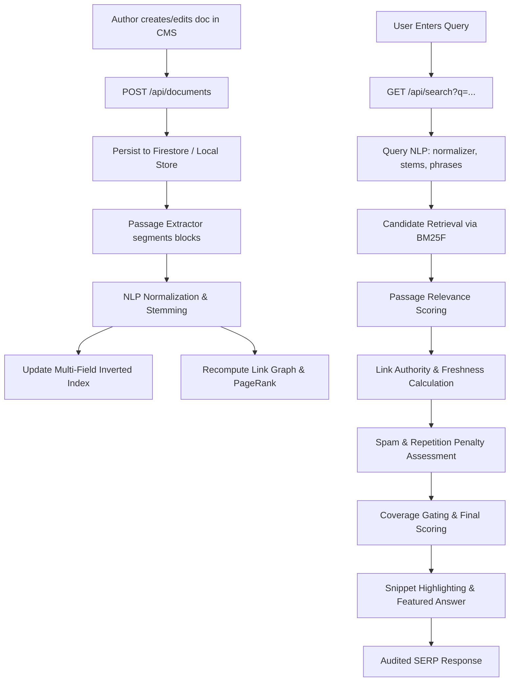

# PESE Architecture: The Local Search Laboratory 😈

## Overview

**PESE (Personal Evil Search Engine)** is an authentic miniature information-retrieval system built for local exploration of competitive document ranking.

Unlike typical website search bars that perform naive database substring queries (`LIKE '%term%'`) or call external cloud LLMs, PESE features a **modular Python information-retrieval engine** coupled with a modern **Next.js** application.

---

## Architectural Principles

1. **Python Owns Ranking**: All lexical normalization, tokenization, stemming, inverted indexing, multi-field BM25F scoring, passage-level extraction, internal graph analysis, spam detection, and scoring traces reside strictly in Python (`PESE/engine`).
2. **Next.js Owns Presentation & Authoring**: Next.js (`PESE/web`) delivers the minimal search engine homepage, the SERP result interface, personal knowledge reading pages, and the `/admin` CMS.
3. **No CMS Relevance Sliders**: Authors control document content (titles, headings, text, tags, markdown links). Search ranking order is computed deterministically by the Python engine.
4. **Firestore as Document Source of Truth**: Firestore represents the canonical authored store. For seamless zero-friction local development, a local persistent JSON document store mirrors Firestore collections when cloud credentials are not supplied.
5. **Full Explainability**: Every search result produces an auditable `RankingTrace` explaining exactly why one document outranked another.

---

## Component Topology

```text
+-------------------------------------------------------------+
|                      Next.js Web (App Router)               |
|  - Search Homepage (/)                                      |
|  - Search Engine Results Page (/search?q=...)               |
|  - Knowledge Reader (/doc/[slug])                           |
|  - Knowledge CMS (/admin)                                   |
|  - Benchmark Dashboard (/admin/eval)                        |
+-------------------------------------------------------------+
                               |
                        HTTP / JSON (localhost:8000)
                               |
+-------------------------------------------------------------+
|                  Python Engine (FastAPI Service)            |
|                                                             |
|  [nlp/]         - NFKC normalizer, contractions, Porter      |
|                   stemmer, stopword/intent filter, n-grams  |
|  [indexing/]    - Multi-field inverted index, postings      |
|                   with positions, passage index             |
|  [retrieval/]   - Robertson-Spärck Jones IDF, multi-field   |
|                   BM25F lexical retriever                  |
|  [passages/]    - Paragraph/block extractor, passage-level  |
|                   scoring, featured snippet highlighter     |
|  [link_graph/]  - Internal directed link graph, bounded     |
|                   PageRank and in-degree authority          |
|  [quality/]     - Keyword stuffing detector, thin content   |
|                   penalty, TTR vocabulary diversity         |
|  [ranking/]     - Multi-signal ranking engine, trace audit, |
|                   comparative explanation engine            |
|  [evaluation/]  - 30-query ground truth dataset, MRR, P@K,  |
|                   Recall@K, passage accuracy runner         |
+-------------------------------------------------------------+
                               |
+-------------------------------------------------------------+
|                        Persistence                          |
|  - Canonical Source: Cloud Firestore or Local Store         |
|  - Inverted Index: PESE/engine/data/index.json              |
|  - Behavioural Events: PESE/engine/data/events.jsonl        |
+-------------------------------------------------------------+
```

---

## Data Flow Diagram


