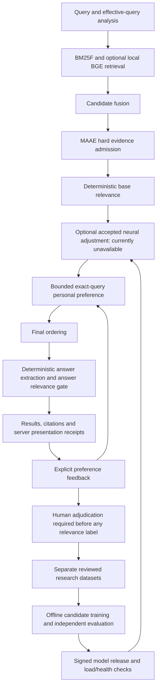

# PESE N3 engineering report — 27 October 2026

## 1. Executive verdict

**The safety/evidence/privacy foundation is implemented and tested. A verified
neural relevance improvement has not been established, and neural ranking remains
unavailable in the release profile. No independent evaluation or training result
has been invented to open that gate.**

The starting checkout was clean at `5b210ae` on `codex/g1-recovery-hardening`.
The implementation ends at `4d724be`, before this report-only commit. No branch
push, tag, binary release, deployment, large download or real Brain experiment
was performed. Existing frozen model files and packaged CPU/BGE assets were reused.

| Phase | Delivered | Gate/limit |
|---|---|---|
| A | Architecture map, source/docs inspection, isolated baseline and defect reproductions | Historical N3-B.1 document absent; assignment findings checked against code |
| B | Versioned readiness validator, server presentation receipts, exact diagnostics, cache provenance, model-version persistence | Historical records remain unverified; votes never become truth |
| C | Replayed Rel-0 audit, grouped curation, ranking/calibration metrics and preregistered acceptance | No independently reviewed relevance dataset or untouched acceptance set |
| D | Bounded ranking integration, trace fields, signature/compatibility gates, killable worker and rollback store | No production trust key/model; end-user activation unavailable |
| E | Per-Brain settings, preference pause/reset, journal permission and exclusion predicate | No journal text trainer or new desktop research collector |
| F | Exact-preview local export, consent/revocation, closed contract, authenticated mock quarantine and deployment specification | No external uploader, endpoint, account or deployed intake |
| G | Reviewed dataset freezing, bounded development trainer, signed artifact packaging/verification | Only synthetic fixture smoke training; no shared learned improvement |

## 2. Architecture



The current code computes preferences while assembling candidates; neural input
uses base scores and the final combined sort follows both adjustments. Rel-0 is
an **answer-support** classifier, not a retrieval-relevance model. Preferences
are a third objective. Neither topical relevance nor a user vote certifies an
answer. The deterministic answer gate remains authoritative after any reorder.

The versioned [architecture contract](n3-architecture-contract-v1.md) specifies
inputs/outputs, stage ownership, normalization, clipping, runtime budgets, cache
receipts, failure behavior, observability, compatibility and rollback. The
experimental neural delta uses ordinal midranks scaled by a capped median base
score gap; raw probabilities are never added to MAAE scores. No experimental
weight configuration has been selected for production.

## 3. Major files changed

| File(s) | Responsibility |
|---|---|
| `engine/intelligence/evidence.py` | Four readiness classes; external trusted receipt/reviewer registries; no vote-to-label conversion |
| `engine/intelligence/contexts.py` | Bounded process-local registry of actually displayed targets and their revisions |
| `engine/search_sync/feedback_store.py`, `contracts.py` | Exact context/type/query/revision/passage/model matching, ambiguity handling, correct agreement counts and persisted model versions |
| `engine/ranking/scorer.py` | Versioned result receipts, cache presentation rebinding, eligible-candidate reranking seam and score traces |
| `engine/search_sync/neural_shadow.py`, `shadow_worker.py`, `__init__.py` | Nonloading diagnostics, frozen artifact integrity, private worker import boundary, production shadow opt-in/isolation |
| `engine/intelligence/reranking.py`, `isolation.py`, `worker.py` | Bounded adjustments; Windows subprocess timeout/memory monitoring; fixed CPU inference code |
| `engine/intelligence/model_release.py` | Ed25519 verification, exact bundle inventory, compatibility/acceptance checks, staged activation/health check and rollback |
| `engine/intelligence/settings.py`, `engine/search_sync/preference_signal.py` | Per-Brain permissions, pause/resume behavior, consent revisions and future collector exclusions |
| `engine/api/main.py` | Verified feedback contexts; settings/reset/preview/export/cancel endpoints; closed activation gates |
| `engine/intelligence/contributions.py` | Strict aggregate-only contribution format and hash-bound local export consent |
| `web/src/components/PrivacyIntelligence.tsx`, settings page, `web/src/lib/api.ts` | User-facing permission explanations, reset confirmation, exact preview/cancel/download UI |
| `engine/intelligence/research.py`, `training.py`, `evaluation.py` | Reviewed curation, contradiction/dedup/leakage checks, immutable manifests, bounded training and paired/group-bootstrap metrics |
| `research/mock_intake.py`, `package_model.py` | Separate authenticated test intake/quarantine/expiry and offline publisher-side signed packaging |
| Four `engine/tests/test_n3_*.py` files | 27 additional tests covering the new contracts and safety boundaries |
| `scripts/n3_rel0_audit.py`, `n3_paired_replay.py`, `verify_n3.py` | Reproducible model diagnostics, exact-input paired baseline replay and isolated full-suite verification |

Canonical Brain schema, protected tables and snapshot versions were not changed.
No runtime dependency was added. Research permissions/datasets are outside the
Drive snapshot allowlist. Tests prove snapshot round-trip/recovery compatibility,
canonical digest preservation and optional permissions resetting after recovery.

## 4. Neural and search evaluation

The [machine-readable Rel-0 audit](n3-rel0-audit.json) rechecks existing **exposed**
synthetic sets. These are regression evidence, not independent release evidence.

| Measure | Frozen test | Exposed prospective |
|---|---:|---:|
| Correct | 102/120 (85.0%) | 20/48 (41.67%) |
| False positives | 17 | 22 |
| False negatives | 1 | 6 |
| Brier score | 0.11258 | 0.43655 |
| Expected calibration error, 10 bins | 0.12978 | 0.46069 |

Frozen-test errors include 13 WRONG_PREDICATE, three SAME_TOPIC_WRONG_RELATION,
one QUESTION_RESTATEMENT and one positive error. Prospective errors include eight
same-topic wrong-relation, seven restatements, six wrong predicates, one missing
information and six positives (including one low-overlap paraphrase). In the
prospective 0.9–1.0 probability bucket, mean P(ANSWERS) is about .92 but observed
positive frequency is only .4444. Literal confidence saturation at ≥.99 was not
reproduced on these sets: zero cases. The overconfidence/generalization failure is
still substantial. One relation-family name, completion_date, is shared across
train/test; this is not proof of source leakage, but disjoint entity/family names
alone cannot establish sufficient template diversity.

Architecture/tokenization constraints remain 512 BPE tokens and 128 input tokens,
trained on narrow English synthetic relations. No new Urdu/Roman Urdu, truncation,
domain-capacity or multilingual improvement is claimed. A larger model is not
justified by these results. The previously exposed test threshold sweep is not
an untouched calibration set and cannot authorize release.

Measured on this Windows host, two torch threads: Rel-0 model/tokenizer load
66.94 ms (excluding initial torch import), batch-one p50 6.79 ms/p95 7.69 ms over
20 warm measurements on the test subset. Model weights occupy 3,569,160 bytes;
the checkpoint including historical training state is 10,794,995 bytes. Whole
audit-process peak working set was 244,711,424 bytes (233.375 MiB), including
Python/torch, not merely incremental model memory. These are developer-host
measurements, not consumer-device budgets. An isolated cold shadow probe failed
its two-second deadline; production shadow therefore remains off by default.

Exact paired source replay used Git revision `5b210ae` and current source with
identical frozen timestamps and separate in-memory feedback. **64/64 top-three
lists and 64/64 answers matched.** Document @1/@3 remained .9531, passage @1 .92/
@3 .94, direct-answer metric .86, abstention metric 1.0. Baseline/current replay
p50 were 4.73/4.19 ms and p95 16.12/8.76 ms; small single runs do not establish a
speed improvement. Before freezing timestamps one tail rank differed among
directory hubs; the existing fixture assigned wall-time timestamps to those hubs.

The existing replay flags one wrong promotion in both revisions: the Delta lab
answer is rendered without markdown, while the evaluator checks containment in
raw markdown. The displayed answer matches the source meaning; this is a scoring
limitation, not a confirmed wrong answer. Historical labels/scoring were not
silently rewritten to improve results.

NDCG@10, MRR, recall/precision, pairwise metrics, grouped paired bootstrap and
calibration tooling are implemented/tested. **No independently measured candidate
ranking improvement exists.** Unjudged results are rejected rather than treated
as irrelevant. Independent acceptance requires ≥300 reviewed queries in ≥30
families, positive grouped paired lower-95% improvement, ≥.02 mean NDCG@10 gain,
critical-category constraints and zero new wrong promotions/gate violations,
plus resource ceilings. No final holdout has been opened or tuned against.

## 5. Training and reproducibility

Existing Rel-0 checkpoint identity remains
`1dd87075cfbf23c09fed5e90be948c6c7af005e9e909ab47e5df6c374b56ff70`;
tokenizer identity remains
`e2023f42797473452a4a702ddb0894b6540277b85f5bdcc7436ecd1587ea03ec`.
Its 892,290 parameters and historical weights were not modified.

The development relevance trainer initializes a dedicated fresh two-layer,
64-hidden, four-head, 128-feed-forward cross-encoder with an explicitly distinct
retrieval_relevance objective. It reuses fixed architecture/tokenizer code, not
Rel-0 weights or answer-support labels. Defaults: CPU/two threads, seed 20261027,
train-only 512-token BPE, sequence length 128, batch 16, AdamW lr .0003/weight
decay .01, gradient clip 1, dropout .1, ten epochs; bounded to 20 epochs, 300 steps
and a 120-second development compute budget. Over-budget partial artifacts remain
experimental and cannot activate search.

Trusted curation must bind a reviewed label to a separately verified receipt and
public/synthetic example text. Query/source/document-lineage/template groups and
exact query/evidence text cannot cross train/validation/calibration/test splits.
Contradictions are errors, repeated observations deduplicate, weak feedback is
quarantined. Semantic correctness of group declarations and reviewer honesty
still require human governance. Dataset directories never overwrite existing
data; manifests hash each split and do not self-declare independent acceptance.

Candidate training reads only train/validation. A fixture removes calibration/test
files and verifies training still runs. Receipts record seed/settings, dataset,
training-code, environment and checkpoint hashes. Release packaging binds the
same checkpoint to protocol/evaluation/sealed-test/review receipt hashes and
rechecks acceptance before producing a signed staging bundle. Production keys
remain empty. Signature verification checks an accountable publisher assertion;
it cannot itself prove that a claimed evaluation was performed honestly.

Only a one-epoch artificial fixture was trained to exercise this plumbing. Its
metrics are not relevance evidence. Ephemeral test keys and fabricated acceptance
fixtures test signing/gates/rollback only; they are never installed as production
trust. **No meaningful PESE-Rel-1 training run, independent result, approved
checkpoint, local journal adaptation or community-trained model is claimed.**

## 6. Privacy and local learning

| Setting | Default | Actual behavior |
|---|---|---|
| Enable neural search | OFF/unavailable | Cannot enable without installed accepted model support; currently API refuses activation |
| Learn from my search feedback | ON for existing N3-A compatibility | Explicit exact-query +2/-4 preferences; no neural parameter update; OFF ignores saved preferences and rejects new votes |
| Research feedback collection | OFF/unavailable | Reserved permission; desktop API refuses enabling an unimplemented collector |
| Allow journal content for local learning | OFF | Records a future local permission only; indexing/search remain independent; no journal trainer exists |
| Excluded document IDs | Empty list | Future research permission predicate refuses excluded documents; no current text collector bypasses it |
| Help improve PESE for everyone | OFF | Enables exact-review local aggregate export only; never enables uploads or local training |

Permissions are per Brain, local, versioned and excluded from backup. Corrupt
permissions fail closed. Reset deletes preference votes/audit/shadow observations,
preserving documents, search history and permissions. Disabling alone retains
records until reset; re-enabling restores their bounded preference behavior.
Tests demonstrate preference movement, exact-query isolation, pause, restart
persistence, reset and journal/exclusion predicates. No improvement in general
retrieval relevance from parameter adaptation is claimed.

Existing canonical feedback/history still contain queries and some shadow evidence
summaries. Manual Drive backup intentionally carries them under the existing
portable contract, independent of community consent; the UI explains this. This
work did not silently scrub old backups or change their schema. New research
files and consent permissions are not transported. No private text is included
in community v1, inference failure logs or the public audit/report artifacts.

## 7. Community pipeline

The [threat model and deployment specification](n3-community-security-v1.md)
describe journal/query leakage, embedding/delta privacy, reidentification,
poisoning/repeats, endpoint compromise, model artifacts and schema mismatches.
Minimized data are not called anonymous.

Completed: strict v1 aggregate contract, suppression/count buckets, exact preview,
cancel/expiry/review/hash enforcement, consent revisions/revocation, local JSON
download, endpoint abstraction that refuses external submission, mock auth/rate/
size/version validation, deduplication, quarantine, expiry deletion, offline
curation and signed release foundation. Mock intake accepts only explicit test
review and never makes a package training-eligible. v1 cannot share example text,
even if someone adds a purported text-consent field.

Unconfigured: external transport consent contract, verified recipient/domain,
gateway account, private storage, deployed distributed quotas, operational review/
deletion service and publisher keys. The specification proposes HTTPS Worker +
private R2, no embedded desktop secret, short-lived capabilities, distributed
limits, 30-day configurable quarantine, minimal logs and manual reviewed promotion.
No real intake deployment or automatic external sharing was attempted.

## 8. Verification, commands and commits

See [verification receipt](n3-verification.json). Final combined Python run:
**464 passed, zero failed/errors/skips, 51.86 seconds**. After the final strict
envelope change: **13 privacy/community tests passed**. The final signed-packaging
fixture also passed **3 research tests**. Frontend production build, TypeScript
and all 12 generated static pages passed.

The tests cover exact linkage, forged/expired contexts, ambiguity/repeats,
nonloading disabled models, score bounds, controlled eligible-order movement,
no candidate resurrection, failure/crash/timeout/memory fallbacks, signed artifact
integrity/health/rollback, consent defaults, independent local/external controls,
pause/reset/revocation, no-text contract, mock quarantine/limits, dataset leakage,
calibration metrics and canonical snapshot/recovery compatibility. A new test
runs 24 concurrent cached presentations with separate context receipts.

Reproduction from repository root with an existing PESE CPU Python runtime:

```powershell
# Choose a NEW output directory outside the application checkout.
& 'D:\Personal Evil Search Engine\g1-final-acceptance-build\stage\runtime\python\python.exe' scripts/verify_n3.py `
  --workspace '../n3-work/verification-new' `
  --model-path '../g1-final-acceptance-build/stage/models/fastembed/models--Qdrant--bge-small-en-v1.5-onnx-Q/snapshots/aa8f8b060edb00e03bfdd08813a2949946c8ba55'

$env:NEXT_TELEMETRY_DISABLED='1'
cd web
npm.cmd run build
```

`verify_n3.py` creates/initializes a fresh synthetic Brain before imports, isolates
the profile and TEMP/TMP, selects existing BGE files and forces offline model
behavior. It refuses an existing output directory or a Brain inside the app.
JUnit and verification receipts are retained in that workspace. The old project
venv points to another account's unavailable interpreter; it was not repaired or
used. Initial sandbox loopback/path failures and a missing default Brain identity
were corrected by the harness rather than changing application safeguards.

Rel-0 replay command: `python scripts/n3_rel0_audit.py --output report.json`.
Exact baseline replay: `scripts/n3_paired_replay.py --source-root <local-source>
--output <json>`, with explicit synthetic Brain/profile environment. A Git archive
of `5b210ae` supplied the original source. `git diff --check` passed.

The loopback **source** smoke test started FastAPI with packaged local BGE and
the built static frontend on a disposable Brain. Readiness/defaults passed;
synthetic clock search returned “Nadia”; Settings HTML returned 200; contribution
preview contained no text, was unreviewed initially, and named only a local
destination. The server was stopped. A first test-helper request used the wrong
static file suffix; the correct exported `/settings/` directory route passed.
This was not a product route defect.

The .NET build command was `.tools/dotnet/dotnet.exe build
host/PESE.Desktop/PESE.Desktop.csproj --no-restore -c Release`. It could not start:
the existing SDK lacks its runtime configuration/hostpolicy support. The system
SDK is also unavailable. No .NET/native build or installed-desktop startup/update
acceptance is claimed. Browser visual inspection failed because the automation
runtime could not initialize kernel assets. Live Google Drive/account acceptance
was not run; Drive protocol/recovery mocks and compatibility tests did pass.

| Commit | Work |
|---|---|
| `3e59a41` | Baseline map and reproduced defects before implementation |
| `1dc98e5` | Evidence readiness, search receipts and diagnostic repair |
| `b17803f` | Reviewed curation, evaluation pipeline and preregistered gates |
| `50ef378` | Bounded neural seam, isolation, signed model contract and rollback |
| `698644f` | Per-Brain privacy controls and reviewed local export UI |
| `c08f0ec` | Mock quarantine intake and deployment/security specification |
| `ce147a8` | Grouped evaluation, bounded candidate training and signed packaging |
| `4d724be` | Exact revision/model joins, revocation, strict envelopes and verification harness |

## 9. Known limitations

Independent relevance data/labels, graded fully judged ranking acceptance,
untouched multilingual/hard-negative benchmarks and measured model improvement
are absent. Existing exposed classifier results cannot fill this gap. The new
trainer is development tooling; there is no trained/approved Rel-1 to distribute.

The model store/packager are offline release foundations, not an installed model
management UI or automatic updater. Public keys are intentionally unconfigured.
The shadow cold-process budget failed in a diagnostic probe. Worker memory uses
10 ms sampling rather than a kernel allocation limit. Large-Brain, constrained
consumer hardware, sustained concurrency, GPU behavior and full CPU utilization
were not benchmarked. Native desktop cancellation/update/restart/UI responsiveness
were not revalidated. Existing cache-generation/recovery tests passed, but they
do not replace those installed acceptance cases.

Journal permissions/exclusions are a safe foundation with no text trainer or
research collector behind them. Community v1 cannot provide training labels.
Human reviewer trust, semantic grouping, distributed poisoning detection and
honest independent evaluation remain operational responsibilities. No real cloud
storage, retention deployment, contribution delivery or deletion has been proven.

## 10. Recommended next release

| Capability | Recommendation |
|---|---|
| Experimental neural ranking | Research-only code/fixtures; no end-user activation until an accepted signed relevance model exists |
| Production neural ranking | **Not ready**: independent ranking/answer/resource acceptance blocked |
| Local learning | Existing bounded explicit preferences and pause/reset controls can proceed to desktop acceptance; neural/journal parameter training is not ready |
| Community contributions | Local preview/export can proceed experimentally after desktop UI acceptance; external uploads/hosted intake remain disabled |
| Global model updates | Offline contract/packaging/rollback foundation only; no community-trained improvement or signed production model release |

Next evidence milestone: independently curate and seal the preregistered relevance
benchmark, then train only on development data and compare the exact integrated
pipeline once against that sealed acceptance set. Restore a working Windows SDK
and complete installed desktop/UI/backup acceptance before publishing binaries.
