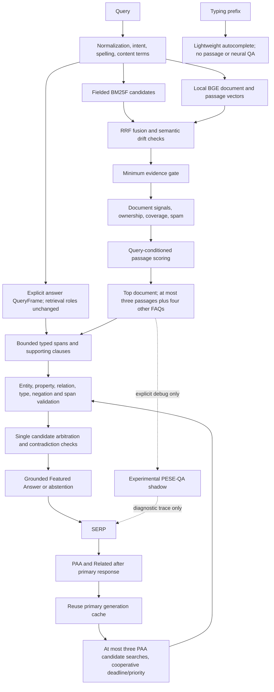
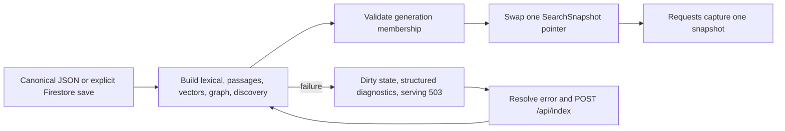

# Phase 2 architecture and ownership

This describes the RC2 implementation. The historical RC1 verdict remains in [its final report](phase-2-final-report.md); RC2 measurements and verdict are in [the RC2 report](phase-2-rc2-report.md).

The relation matcher is diagnostic only in the release. The first independent run exposed an unsafe topical match even at its conservative threshold, so it no longer authorizes production answers. It is not an entailment model; general relation recall remains an open acceptance item. Deterministic lexical variants still support some paraphrases. Local coreference resolves only constrained leading pronouns using nearby evidence; it does not perform general parsing or multi-hop reasoning.

Answers come only from the highest-ranked document. RC2 inspects up to three scored passages plus four additional FAQs from that source, at most 24 sentences per passage and 64 candidates. It performs no second corpus search. A valid answer in a lower-ranked document can still be missed. Neural shadow output cannot overwrite this decision. Main search skips QA unless debug is explicitly requested.

`answer_pipeline.py` owns production QueryFrame parsing, typed candidate generation, proposition checks and the one final arbitration. It separates answer span, support sentence, support clause and support passage. Entity/object binding, predicate, property, type, grounding, negation and conflicts are hard constraints; retrieval or embedding similarity cannot override them. Any validator exception abstains for the whole request and avoids caching that failure. Explicit current-policy structure can resolve an archived policy; otherwise competing supported scalar values or polarities abstain.

The retained `answer_extractor.extract_answer` and `answer_relevance.py` single-passage API supports legacy tests and diagnostic reconstruction. The legacy query decomposition also remains in passage-ranking signals to preserve retrieval. It is not a competing production answer authority. New QueryFrame roles are dependency-lite anchors and requested slots, not a complete grammatical parser. Operational definitions, payment modes, a small set of property equivalents, and conservative nearby references are supported; broad paraphrases, complex ownership and general coreference remain limited.

## CMS publication

The canonical published-document digest is the snapshot ID used for lexical, semantic, passage, FAQ and graph versions. `/health` reports that digest separately from the canonical store digest and the process boot ID. Discovery uses a read-only document view from the same generation. Legacy globals remain for laboratory compatibility; serving search, autocomplete, PAA and Related capture the published snapshot.

Local writes are serialized in one process and use atomic file replacement. Failure after a successful canonical save is **not** rolled back; the dirty state blocks serving until recovery. Startup rebuilds from canonical data. API snapshot builds do not publish partially persisted derived vector files. Multiple API workers, external writers and distributed Firestore transactions are unverified.

## Modification map

| Responsibility | Owner |
|---|---|
| Query intent/content terms | `engine/query_analysis/analyzer.py`, `intent.py`, `engine/nlp/stopwords.py` |
| Spelling and vocabulary | `engine/query_analysis/spelling.py`, `engine/nlp/stemmer.py` |
| BM25F retrieval | `engine/retrieval/`, `engine/indexing/inverted_index.py` |
| Dense retrieval and drift/fusion | `engine/semantic/provider.py`, `index.py`, `retriever.py`, `drift.py`, `fusion.py` |
| Document ranking and ownership | `engine/ranking/scorer.py`, `signals.py`, `evidence_gate.py` |
| Passage extraction and scoring | `engine/passages/extractor.py`, `scorer.py` |
| Production answer roles, candidates, validation and arbitration | `engine/passages/answer_pipeline.py`, production entry point in `answer_extractor.py` |
| Legacy gate and ranking-role compatibility | `engine/passages/answer_relevance.py`, retained single-passage extractor |
| Bounded references and semantic relation aid | `engine/nlp/local_context.py`, `engine/semantic/relations.py` |
| Spam and quality | `engine/quality/` |
| PAA, Related, autocomplete | `engine/discovery/questions.py`, `related_searches.py`, `autocomplete.py` |
| Secondary CPU cooperation | `engine/discovery/priority.py` |
| CMS storage, snapshots, diagnostics | `engine/indexing/store.py`, `snapshot.py`, `engine/api/main.py` |
| Demo/private configuration | `engine/config.py`, `engine/data/demo_corpus.py` |
| Frontend requests and cancellation | `web/src/lib/api.ts`, `web/src/app/search/page.tsx`, `SearchAutocomplete.tsx` |
| CMS editor | `web/src/components/DocumentEditorForm.tsx`, `StructuredEditor.tsx` |
| Experimental QA/data grouping | `engine/neural/`, especially `data/grouped_split.py`, `experiments/qa_runner.py` |
| Release measurement and manifests | `engine/evaluation/rc2_*`, `phase2f_*`, `qa_v2.py`, `holdout_run.py`, `release_manifest.py`, `release_hygiene.py` |

The result cache belongs to one engine generation and caps at 32 entries. Query embeddings and relation embeddings cap at 256 each; spelling and lexical helper caches have separate count caps. Count bounds are measured, not claimed to be byte bounds. History remains a local JSONL discovery input, not a learned document ranker.
