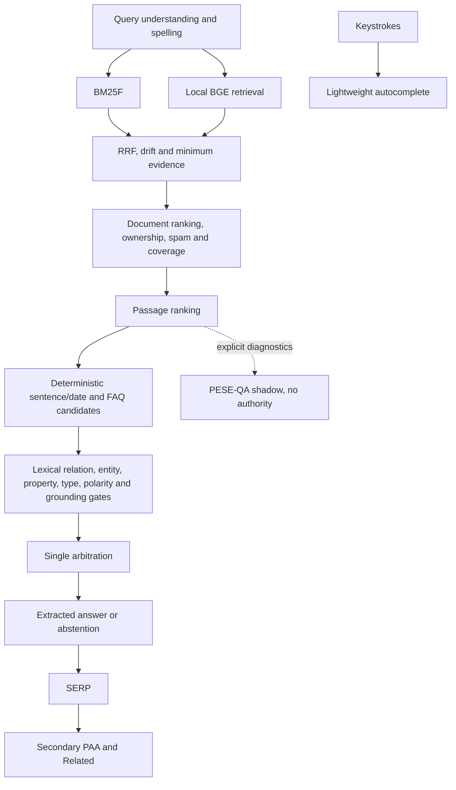

# PESE Phase 2 final report

Date: 23 October 2026. Candidate: **PESE Phase 2 — Search Intelligence Baseline, 2.0.0-rc.1**.

## 1. Executive Summary

**PHASE 2 NOT ACCEPTED.**

Retrieval and several reliability controls are credible. General direct-answer behavior is not ready for final acceptance. An independently authored, sealed 48-question holdout found the supporting document first in 43/45 answerable cases, but produced only five correct final answers. It also exposed one wrong answer promoted by the newly introduced relation-embedding path. That path was subsequently disabled for production answers. A clearly labeled exposed regression replay removed the wrong promotion but retained only 5/45 correct-answer recall.

Actual browser/CMS acceptance and primary-visible browser timing could not be completed: both browser and native automation failed during initialization with `failed to write kernel assets` / `os error 3`. API lifecycle checks and frontend HTTP responses are recorded separately; they do not substitute for the missing UI checks.

The original holdout result is preserved. No post-fix replay is represented as blind. No Phase 3 feature, model promotion, public deployment or publication occurred.

| Acceptance evidence | Result |
|---|---:|
| Independent Doc@1 / @3 | 43/45 / 45/45 |
| Independent Passage@1 / @3 | 41/45 / 45/45 |
| Independent correct-answer recall | 5/45, 11.11% |
| Independent overall answer/abstention accuracy | 8/48, 16.67% |
| Independent wrong promotions | 1/48; 1/6 promoted answers |
| Post-fix exposed replay wrong promotions | 0/48; recall remains 5/45 |
| Release tests with installed optional checkpoint | 128 passed, two warnings |
| Source-only demo tests | 126 passed, two optional checkpoint skips, two warnings |
| Frontend static checks | TypeScript passed; lint zero errors, 29 warnings |
| Clean frontend installation/build | Passed in isolated source copy |
| Browser primary-visible latency / actual CMS UI | Not verified |

Evidence: [independent report](audit/phase2f-holdout-report.md), [exposed replay](audit/phase2f-holdout-regression-report.md), [final source snapshot](audit/phase2f-final-snapshot.json).

## 2. What Phase 2 Built

PESE is a local, in-memory hybrid corpus search engine with BM25F, local dense retrieval, reciprocal-rank fusion, structured passages, spelling recovery, conservative extractive answers, FAQs, discovery and a CMS. Explainable component traces and explicit abstention are part of the implementation. Neural QA remains a separate experiment.

Phase 2F added generalized first-person ownership scoring; retained full FAQ metadata during quality/spam analysis; precomputed corpus-level quality and passage helpers; added field/FAQ stuffing checks, constrained local references and explicit current-policy passage preference; implemented atomic search-snapshot publication and dirty-state diagnostics; bounded secondary discovery work; added frontend request cancellation and keyed query state; introduced pinned Python dependencies, public demo isolation, source manifests and the final independent evaluation.

The five Phase 2E failures were examined rather than forced to reproduce obsolete behavior:

| Old failed test | Classification | Disposition |
|---|---|---|
| Payment paraphrase with no named organization | BAD TEST DESIGN | The fixture could not establish Healing Lounge ownership. It now supplies the organization in its evidence while retaining the fee/installment paraphrase. |
| Multi-date test requiring the old Japan slug | STALE EXPECTATION | Test isolated public event evidence and the correct date, allowing a more specific evidence page to compete. |
| Typo test requiring the old Japan slug | STALE EXPECTATION | Preserve correction/topic correctness; spelling success does not require one historical slug. |
| Meiji passage test requiring Japan first | STALE EXPECTATION | Accept the specific Meiji page or a relevant parent passage and inspect the actual passage. |
| Neural dream-date assertion | KNOWN UNSUPPORTED CAPABILITY | Keep the model-quality failure documented. Production tests now prove that an injected wrong shadow date cannot overwrite the grounded answer; separate QA evaluation still measures the model's poor accuracy. |

Previously private-corpus-dependent tests now use isolated synthetic fixtures. Test portability also required explicitly opting into history in persistence tests and allowing absent optional QA artifacts. A rapid atomic file-replacement regression exposed modification-time collisions; the store cache now also checks file identity, size and creation time.

## 3. Final Architecture

The actual pipeline and ownership map are in [Phase 2 architecture](phase-2-architecture.md).

Only the top document's selected passage produces the primary answer. Relation embeddings are now diagnostic only. No generative answer or unrestricted reasoning step exists. The internal link graph supplies capped authority; it is not a semantic knowledge graph.

## 4. Retrieval Metrics

The independent collection contains 76 synthetic documents and 48 questions. Its 45 answerable questions supply retrieval denominators: Doc@1 **95.56%**, Doc@3 **100%**. The two first-rank misses selected a cargo launch over a requested ferry and speaker-return instructions over projector-cooling instructions. Both requested sources were present in the top three.

The exposed 64-case development suite reports Doc@1 **93.75%**, Doc@3 **95.31%** on the release source. This is development/regression evidence, not an independent accuracy estimate. Its favorable answer result did not predict the much worse holdout answer result.

The actual private API now ranks `my-first-bicycle` first for “what are my bicycle specifications.” It still abstains from a direct specification answer. Generic SEO commentary no longer wins that checked query. Ownership is a bounded signal from query possessives, document identity and first-person text; it is not a personalization engine or a general ownership resolver.

See [release development metrics](audit/phase2f-development-release.json) and [private API regressions](audit/phase2f-api-regressions.json). Raw private source passages remain outside the public report.

## 5. Passage Metrics

Independent Passage@1 was **41/45, 91.11%** and Passage@3 **45/45, 100%**. These use the captured order: up to three passages from the first document, followed by passages from later documents; the first three flattened entries define Passage@3. This is not a separately trained global passage ranker. Unanswerable questions have no required supporting passage and are excluded.

The development suite reports Passage@1 **92%**, Passage@3 **94%**. Focused synthetic tests verify railway/museum date separation and heading-aware historical passages. Full-body term counts are saturated, sentence coherence matters, and explicit current-policy headings can beat archived-policy headings.

Good passage recall did not imply good answer extraction: the independent author found **20 correct candidate spans suppressed** in the original run. Selecting only one winning passage also missed FAQ evidence present at later passage ranks.

## 6. Answer Metrics

The original independent run promoted six answers: five correct and one incorrect. Correct-answer recall was **11.11%** and promoted precision **83.33%**. Overall accuracy, including correct abstentions on unanswerable questions, was **16.67%**.

The incorrect case asked who repaired a station clock. The promoted sentence said that the clock stopped during a storm. It was an extracted, grounded sentence, but it did not answer the repairer relation. Its relation cosine was **0.8511**, above the proposed **0.84** threshold. This demonstrated that the similarity aid could authorize topical nonsense despite other checks.

The release disables attaching relation embeddings to the production answer gate. An exposed regression replay now promotes five correct answers and no incorrect answer; correct-answer recall remains **11.11%**. This safety fix does not establish independent release accuracy. The original frozen run was not overwritten or reclassified as passing.

The development suite reports valid-direct-answer recall **78%** on 50 answerable cases, zero observed wrong promotions and the same 64 total cases as before. Its rubric is substring/source based, with stricter year handling; the independent author separately reviewed source, requested relation and answer correctness. The discrepancy is the central acceptance failure, not an excuse to discard the holdout.

## 7. Abstention Metrics

All **3/3** independently unanswerable questions abstained. That denominator is too small for a general safety claim. The original run also falsely abstained on **39/45** answerable questions; the safety replay abstained on **40/45**. Silence is safer than an unsupported answer, but this level of false abstention is insufficient to close the answer-recall acceptance item.

Gate traces most often exposed entity decomposition/matching failures, predicate mismatches and missing property terms. The gate remains fail-closed on exceptions. FAQ authority cannot bypass query, source or answer validation. Local positive/negative policy conflicts abstain unless explicit document structure resolves the selected passage.

## 8. Typo Recovery

The expanded development spelling study measured **100 generated mutations**, **40 preservation controls**, **100% observed correction precision**, **59% recall**, and **0/40 false corrections**. It includes transpositions, deletions, insertions, substitutions, two-edit variants and proper nouns. Its original `wrong_vowel` label actually described a midpoint substitution; that raw artifact is preserved with this limitation stated explicitly.

A separate supplement adds **41** genuine vowel replacements, technical transpositions, proper-noun deletions and short ambiguous inputs: **100% observed precision**, **56.10% recall**, zero incorrect changes. These are small generated development sets, not dictionary-wide guarantees. Rare words and ambiguous short inputs are often left unchanged.

Actual API prefixes `p`, `pe`, `pes`, `pese`, `j`, `ja`, `jap`, `japn`, `japna` were exercised. `japna` still recovers to Japan. Autocomplete uses corpus/history metadata and spelling, without passage ranking or neural QA. Browser typing and stale-response behavior remain unverified at runtime; generation guards, fetch aborts and unmount cleanup were checked in code and TypeScript/lint.

Evidence: [spelling study](audit/phase2f-spelling.json), [supplement](audit/phase2f-spelling-supplement.json), [autocomplete API checks](audit/phase2f-autocomplete.json).

## 9. Spam / Quality

Short content is not penalized solely for brevity. Tests pit a concise exact fact against title, heading, body, metadata and repeated-FAQ stuffing. Document reconstruction now retains FAQs, so repeated FAQ content reaches spam analysis. Quality/spam signals are computed once per generation rather than repeatedly for each query.

Focused competition tests pass, including an older exact instrument fact versus a newer, highly linked irrelevant page. Link authority and freshness remain additive secondary terms after query evidence; they cannot create missing answer evidence. Freshness follows metadata decay rather than general temporal reasoning.

The sensitivity study observed zero spam winners across 21 configurations. Independent spam-competition questions retrieved the expected source first in 3/3 cases, but produced only 1/3 correct final answers. Ranking robustness and answer completeness remain separate claims.

## 10. Semantic Retrieval

Production retrieval uses local normalized 384-dimensional BGE embeddings at document/passage level, dense/lexical fusion, drift guards and conservative rescue thresholds. There is no external LLM.

The 67-query development sensitivity study varied title, heading, passage, dense, RRF and coverage weights by ±20%, plus semantic rescue, semantic fusion contribution, weak-drift threshold and the then-active relation threshold. Across 21 configurations, Doc@1 ranged **88.06–89.55%**, with zero spam winners. Baseline attribute-ranking failures in that study were zero. No catastrophic dependence on a tiny dense-weight change was observed on this dataset. Threshold effects can be small when few examples reach the relevant decision boundary; this is not universal calibration.

A small eight-pair relation probe failed to separate enough true paraphrases at the conservative threshold. The independent wrong promotion then showed that even a high similarity could be unsafe. **Relation-semantic answer authorization is disabled in the release.** Its module remains available for diagnostics; no claim of solved relational understanding is made. General paraphrase recall remains open.

Evidence: [sensitivity](audit/phase2f-sensitivity.json), [relation probe](audit/phase2f-relations.json).

## 11. PAA / Related

PAA requires both question topicality and a validated answer from its expected source. Identical FAQ questions retain source identity in the pool. Candidate evaluation is limited to three searches, with a soft 250 ms loop budget and a primary-request check between candidates. One in-progress candidate can overrun that budget. Secondary API routes reuse a cached primary result instead of repeating the primary search; a missing cache entry can produce empty discovery.

The synthetic API acceptance returned the Harbor Clinic installment question with its matching source answer. Manual assessment: **question relevance 1/1; answer correctness 1/1**. Unsupported queries omitted PAA items. This tiny sample is not a broad PAA-quality estimate.

Related suggestions are deduplicated and do not run QA. A remaining contamination was observed: “Japan history” could include an unrelated Aurora Observatory suggestion because weaker retrieved results still influence some family suggestions. This is a known failure, not a resolved “no contamination” claim. Related and PAA use separate state.

PAA HTTP p50/p95/max were **17.57 / 277.06 / 295.13 ms** under the measured cache-aware workload. The old PAA tail is substantially reduced in this sample; UI priority under rapid navigation is not verified. See [performance](audit/phase2f-performance.json) and [synthetic lifecycle/discovery checks](audit/phase2f-cms-api.json).

## 12. CMS / Index Consistency

Search, autocomplete, PAA and Related requests capture one `SearchSnapshot`. Administrative/laboratory compatibility aliases remain. Lexical, passage, vector, graph, autocomplete, Related and PAA components are built before one pointer swap; discovery reads a frozen document view. The canonical published-document digest serves as the unified generation ID for all searchable components. Process boot ID is separate.

Canonical JSON writes use a flushed temporary file and atomic replacement. API snapshot builds do not persist half-built derived generations. If rebuilding fails after a canonical save, the API returns `SAVED_NOT_INDEXED`, `/health` reports the failed stage and dirty state, and search returns `INDEX_NOT_CURRENT` until recovery. This favors unavailable search over silently serving an unpublished document. Tests inject lexical, semantic and FAQ/discovery failures, verify no partial publication, then verify recovery and removal of the unpublished source.

The isolated API lifecycle verified publish (2011), edit (2018), FAQ add (port 6401), FAQ edit (6402), FAQ removal, unpublish and final deletion of the explicitly named temporary page. The demo returned to 11 published documents. Integration tests verify lexical, vector, FAQ and graph freshness. No user corpus reset was performed.

**Actual frontend CMS create/edit/remove/unpublish remains unverified.** UI automation failed before navigation. Process-crash behavior is supported by canonical atomic replacement and startup rebuilding; a forced crash/power-loss fault-injection campaign was not run. Multiple workers and external writers are outside the verified model. External manual edits require reindexing; health can expose a canonical/snapshot mismatch.

## 13. Performance

HTTP statistics use nearest-rank percentiles and 36 samples per row. The workload is model-warm and cache-aware, with 12 queries repeated three times; 25/36 isolated primary requests were cache hits. Concurrent primary calls followed an isolated call for the same query. These are not uncached browser benchmarks.

| Local HTTP path | p50 | p75 | p95 | Max |
|---|---:|---:|---:|---:|
| Isolated primary | 7.22 ms | 27.97 ms | 91.93 ms | 196.29 ms |
| Subsequent concurrent primary | 16.38 ms | 21.91 ms | 37.57 ms | 38.84 ms |
| PAA | 17.57 ms | 26.51 ms | 277.06 ms | 295.13 ms |
| Related | 31.71 ms | 38.79 ms | 164.42 ms | 283.47 ms |

These timings preceded the final safety disablement, which removes relation-gate work. They are retained with that provenance, rather than advertised as final browser performance. Precomputed quality, direct per-document passage lists and precomputed sentence terms remove repeated document-global work. Frontend primary fetching precedes discovery; old fetches are aborted and stale completions ignored. Backend secondary loops cooperate between candidates; native inference and older synchronous primary requests are not forcibly preempted.

A fresh API probe with installed model/vector caches became ready in **8,356.34 ms**. First search HTTP was **207.54 ms**; the different payment query was **33.57 ms**. This excludes model download. Lexical-ready and semantic-ready wall-clock milestones were not separately instrumented in that HTTP probe. The clean production web server logged readiness in **416 ms**; an HTTP shell is not proof of browser usability.

No Phase 2F browser p50/p75/p95/max was measured. The Phase 2E browser result remains historical evidence only. The preferred ≤500 ms p50 and ≤1,000 ms p95 primary-visible targets are **unverified** for this release. The legacy cold runner reused its historical output filename; the new sample is preserved as [Phase 2F cold HTTP](audit/phase2f-cold-http.json), and the old artifact path is explicitly marked superseded rather than silently presenting new numbers as Phase 2E data.

## 14. Memory / Cache

The bounded soak ran **10,000 distinct query keys** with real BGE on a fixed synthetic 39-document corpus, sequentially, with QA disabled. Unique numeric suffixes forced cache misses; this is a memory workload, not natural-language accuracy evaluation.

| Checkpoint | RSS after GC | Result entries | Query embedding entries |
|---|---:|---:|---:|
| Before soak | 648.14 MB | — | — |
| 1,000 | 651.74 MB | 32 | 256 |
| 5,000 | 652.63 MB | 32 | 256 |
| 10,000 | 653.73 MB | 32 | 256 |

Total growth was **5.59 MB** over **157.4 seconds**. Query p50/p95 were **13.14/24.38 ms**. The relation cache remained empty in this workload; its configured cap is 256. Estimated serialized cached result bytes at 10,000 queries were about **218.5 KB**, excluding Python overhead and list-level metadata.

There was small continued allocator/cache growth, not a demonstrated perfectly flat RSS plateau. Entry bounds and modest observed growth did not justify a complex byte-LRU change. Query/passage size extremes, other corpora, concurrent long-running workloads and history-file growth were not established byte-bound guarantees. See [soak record](audit/phase2f-soak.json).

## 15. Dependency Reproducibility

Pinned runtime and development Python manifests now cover FastAPI, Pydantic, NumPy, Fastembed, ONNX Runtime, Firebase Admin, CPU PyTorch and their dependency closure. A new isolated CPython 3.12 environment installed them successfully; `pip check` found no broken requirements. The clean source export excludes the personal corpus, environment files, derived indexes and optional QA checkpoints; its release tests passed **126**, with **two optional skips**. The installed-checkpoint environment passed **128**.

A clean `npm ci` and production build passed in an isolated frontend source copy. TypeScript passed. Frontend lint changed from the audited target-file errors to **zero errors across all source, 29 warnings**. Remaining warnings are primarily unused imports/variables, one editor dependency warning and existing component parameters. They are retained in the static-quality/lint evidence. Python syntax parsing passed for **151 final Python sources**; no Python type checker or linter is configured.

The two Python warnings are a Starlette TestClient deprecation for `httpx` and a `datetime.utcnow()` deprecation in checkpoint metadata. Neither was hidden by changing expected outcomes. No tooling migration or automatic checkpoint retraining was performed.

`npm audit --omit=dev` reported **zero production vulnerabilities**. The full audit reported **five high development dependency paths** through the same `braces` stack-exhaustion advisory; its suggested automatic fix downgraded the Next lint stack across a major version. No forced downgrade was applied. This development advisory remains open. The original checkout also hit a Turbopack CSS-worker failure after the isolated build passed. Reinstalling the locked dependencies and removing only the generated `.next` cache restored a successful production build. No application source workaround was introduced.

Setup and troubleshooting: [installation guide](installation-guide.md). Reproducibility is verified for the stated Windows/Python/Node target, not every platform.

## 16. Privacy / Open-Source Readiness

**Not ready for whole-directory publication. Nothing was published.** The readiness scan found 39 local data files requiring review/exclusion, three derived vector files, thirteen checkpoints and one local environment file. It found no credential signature in the explicit source allowlist, which is not proof that secrets never existed elsewhere or in history.

The public demo defaults to separate synthetic documents, history and vector locations, and starts with history disabled. Ambient cloud credentials alone no longer select Firestore. The legacy hardcoded personal seed and neural playground personal passage were replaced with synthetic examples; the old seed is retained only in ignored private audit backup storage. The user's canonical private corpus was not rewritten.

Source-only startup and tests ran without private data files or QA checkpoints. A publication inventory still flags eighteen source files for review of personal-name references, local paths or legacy-store references. Historical reports, evaluation text, private stores, logs and checkpoints need explicit review/exclusion. `.gitignore` is not proof of a clean repository: there is no `.git` here, so tracked-file and history audits cannot be certified. See [readiness inventory](audit/phase2f-public-readiness.json).

## 17. PESE-QA Final Decision

**EXPERIMENT / SHADOW / NON-AUTHORITATIVE.** The model was not promoted or retrained.

The legacy checkpoint cannot be retroactively made leakage-free: its original training had five identical contexts across train/validation, nine of fifteen old benchmark items reused training contexts, and its tokenizer saw validation data. The future training path now groups source/entity/family evidence before feature construction, excludes benchmark contexts and trains its tokenizer on training examples only. Explicit source/family metadata remains preferable to the fallback heuristics used for old examples.

Dataset V2 contains fourteen synthetic sources: four training, two validation and eight test sources, with paired answerable/unanswerable questions. Exact context hashes and manifests are recorded. V2 test contexts have zero identical-context overlap with the inspected legacy training corpus. Its training-only tokenizer is recorded but does not alter the existing model.

On sixteen V2 test questions, the legacy reader achieved **43.75% EM**, **56.77% token F1**, **68.75% answerability accuracy**, **71.43% no-answer precision** and **62.5% no-answer recall**. Returned spans were grounded **100%** of the time, demonstrating again that grounded text can still answer the wrong question. Calibration buckets are retained in the raw report; confidence is not claimed to be a calibrated truth probability.

Complete deterministic search was **16/16** correct on this small, exposed V2 test. Adding QA shadow changed **zero** authoritative answers and added **zero** complete-search accuracy points. This saturated small set does not establish that neural readers can never help; it establishes no promotion case for this checkpoint. See [QA V2](audit/phase2f-qa-v2.json) and [source dataset](audit/phase2f-qa-v2-dataset.json).

## 18. Independent Holdout Results

An isolated author agent received neither implementation history nor benchmark/corpus content and was instructed not to inspect them. It independently created 76 synthetic documents, 48 questions and sealed labels across sixteen required categories. The implementer received documents/questions only. The final evaluated source hash was verified before and after the **single** production run. Outputs were recorded and hashed before labels were revealed. Raw and adjudicated scores agree; no labels or questions were revised to benefit the engine.

Candidate freezes were checked before final sealing; clean-export failures required test-portability changes before the evaluated freeze. The later semantic safety change happened only **after** the original result was revealed. That later run is explicitly regression evidence.

| Hash subject | SHA256 |
|---|---|
| Independently evaluated source | `0f1aca13a0e257ac6c387260c81b758603468fd5315277836426380def98b744` |
| Input | `5698f09c8b596d0e383b7b8645d238d4ee2699c28b411a3109b95b546951b89c` |
| Original/revealed labels | `a2ab11e3c4eacf524b278179011fe07f3dc2b475b59ecb98c78a6fa4b28ad6cb` |
| Original outputs | `8103065bf5ce00df514e186b15c3660e10bee9fb568ae3da9e3297f5e8732699` |
| Post-safety release source | `51d186b0c06c9077ed34239f3d89be6eb045812215a54fb9408b306fe04368b5` |

Original category answer/abstention results: entity attribute, FAQ, definition, typo and spam competition each scored 1/3; unanswerable scored 3/3; all other categories scored 0/3. The full [independent report](audit/phase2f-holdout-report.md) preserves every stage and category. These small categories cannot estimate population accuracy precisely.

The source manifest supplies the version mechanism because no Git repository exists. The original evaluated manifest, post-safety evaluated manifest and final cleanup snapshot are all retained. The final snapshot hash is `e6098cdbb357835edb545bdb1b3ea15134b726ef3c7e0889b2ff90c5280a321c`; its only difference from the post-safety evaluated source is removal of an obsolete manual query probe from `engine/data/`, preserved as an ignored audit backup. Runtime code is unchanged by that cleanup. **This holdout is now regression data, never blind again.** The post-fix release has no new independent acceptance run.

## 19. Remaining Known Limitations

| Phase 2E acceptance item | Closure status |
|---|---|
| Personal attribute/ownership ranking | Improved and verified on synthetic competition and one private API regression; ownership and attribute answering remain limited. |
| Grounded paraphrase recall | **Open.** Similarity authorization was unsafe and is disabled; general relation recall is not solved. |
| Bounded coreference/cross-sentence support | Implemented for narrow local forms; **open for acceptance**, with 0/3 correct answers in each independent category. |
| Independent holdout | Procedure completed honestly; result **fails answer acceptance**. |
| PAA tail latency | Improved in measured HTTP workload; browser contention/priority remains unverified. |
| Cache/memory bounds | 10,000-query soak completed; entry caps observed, byte-extreme workloads remain unverified. |
| Dependency reproducibility | Clean Python and frontend installation verified for Windows target; development advisory remains; the existing-install build was restored by clearing generated cache. |
| Store/index diagnostics | Single-process snapshot publication, failure diagnostics and recovery verified; distributed writes and forced-crash testing remain outside evidence. |

Further limits include incorrect query role decomposition, strict property requirements suppressing valid paraphrases, shallow person/type checks, answers restricted to one document/passage, rare spelling misses, Related-family contamination, unbounded history-file size, and optional experimental-model artifacts. The final safety fix removes the known wrong clock promotion; it does not make cross-sentence answers work.

| Capability | Final status | Evidence |
|---|---|---|
| BM25F | Production baseline | Retrieval tests and holdout document ranks |
| Semantic retrieval | Production baseline, limits | Local BGE, sensitivity and holdout |
| Typo recovery | Production, conservative limits | Expanded mutation/control studies |
| Spam resistance | Production, tested limits | Field/FAQ competition and sensitivity |
| Featured answers | Implemented, **not accepted as general capability** | 5/45 independent recall |
| Abstention | Production safety behavior, excessive false abstention | Fail-closed tests; 3/3 negatives; 40/45 false abstentions in replay |
| PAA | Implemented, limited acceptance evidence | Separate relevance/correctness check and HTTP latency |
| Related searches | Implemented, contamination remains | Synthetic API finding |
| CMS indexing | API consistency verified; actual UI unverified | Lifecycle and fault injection |
| Neural QA | Experimental | Leakage disclosure and V2 ablation |
| Behavioral reranking | Not implemented | No learned document reranking |
| Generative answers | Not implemented | Extractive-only producers |
| AI Overview | Not implemented | No such product path |
| Semantic knowledge graph | Not implemented | Only the internal-link authority graph exists |

## 20. Phase 2 Acceptance Verdict

**PHASE 2 NOT ACCEPTED.**

The release is a stronger, reproducibly installable hybrid retrieval candidate with safer publication and diagnostics. It has not earned final Phase 2 answer acceptance. The independent evidence shows insufficient answer recall, the first blind run exposed an unsafe relation promotion, and mandatory browser/CMS checks remain unverified. The safety patch and green regression suite do not erase those findings.

Keep this candidate and its evidence as the named Phase 2 snapshot. Any later acceptance decision needs correction of these Phase 2 gaps and fresh independent evidence where appropriate. No Phase 3 implementation was started.
