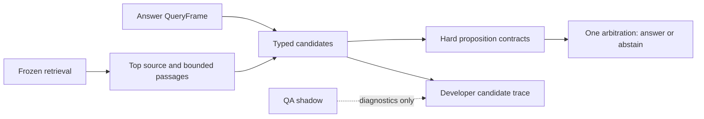

# PESE Phase 2F RC2 report

Date: 23 October 2026. Candidate: **2.0.0-rc.2**. Final verdict: **PHASE 2 NOT ACCEPTED**.

RC2 improves several exposed answer cases and completes actual browser/CMS verification. The fresh independent evaluation still finds the evidence much more reliably than it answers questions: **16/60 correct direct answers**, **16/17 promoted precision**, and **one inappropriate answer promotion**. The independent result does not justify Phase 2 acceptance.

## 1. RC1 failure diagnosis

The [RC1 final report](phase-2-final-report.md), original independent artifacts and safety replay remain unchanged. RC1 was not accepted. Its original blind run found the document first in 43/45 answerable cases and the passage first in 41/45, but answered only 5/45 correctly. The subsequent safety patch removed its wrong clock-repair promotion without improving recall.

Before implementation, RC2 examined all 45 answerable records, including the 20 recorded correct-but-suppressed spans. The initial evidence was incomplete: RC1 persisted its last diagnostic candidate rather than every producer candidate. The [preimplementation diagnosis](audit/phase2-rc2-rc1-diagnosis.json) explicitly records that limitation rather than inventing historical logs.

A later, separately labeled [legacy reconstruction](audit/phase2-rc2-rc1-candidate-reconstruction.json) instruments the retained legacy extractor and unchanged legacy gate. It reproduces **45/45 historical final outputs** and records **89 gate-evaluated candidates**. This is new diagnostic evidence, not recovered historical telemetry. It corrected several initial root-cause assignments; the [verified diagnosis](audit/phase2-rc2-rc1-diagnosis-verified.json) contains all queries, sources, passages, reconstructed generated/suppressed spans, finals, reasons and gate features. Completing this full candidate reconstruction after implementation is a documented deviation from the requested diagnosis-first sequence; the original records and initial analysis remain preserved.

The main defect was mandatory evidence roles, not a low numeric entailment score. Interrogatives and requested properties such as year, color, temperature and mean could become required entities; qualifying or phrasal verbs could become the wrong predicate. Restrictive HOW/date producers, one-passage answering and weak local references then removed other opportunities. Two first-document misses were genuine retrieval failures and were left separate.

## 2. Failure distribution across 45 answers

Five answers were correct; 40 failed in the RC1 safety replay. The refined primary architectural causes are:

| Primary cause | Failed questions |
|---|---:|
| QUERY_ROLE_FAILURE | 18 |
| ENTITY_FAILURE | 1 |
| PREDICATE_FAILURE | 2 |
| PROPERTY_FAILURE | 0 |
| ANSWER_TYPE_FAILURE | 0 |
| PASSAGE_CONTEXT_FAILURE | 4 |
| COREFERENCE_FAILURE | 3 |
| PARAPHRASE_FAILURE | 6 |
| CANDIDATE_GENERATION_FAILURE | 4 |
| CANDIDATE_SUPPRESSION_FAILURE | 0 |
| ARBITRATION_FAILURE | 0 |
| FORMATTING_ONLY_FAILURE | 0 |
| RETRIEVAL_FAILURE | 2 |

Primary categories sum to 40. They describe the main architectural cause, not mutually exclusive symptoms. **20 correct-candidate suppressions** are an overlapping consequence of these causes, not an additional 20 failures. Zero primary property/type/arbitration counts do not imply those components were flawless. The per-case records preserve the actual gate failure and the distinction between historical and reconstructed candidates.

## 3. Correct candidates previously suppressed

All **20/20** recorded correct-but-suppressed candidates already scored at or above the old **0.38** pass threshold. Mandatory entity/property/predicate checks still rejected them. Lowering that score threshold would not repair the mistaken roles.

The diagnosis JSON retains candidate text, source sentence/passage, query, every recorded gate feature, entity/predicate/property/type alignment, polarity preservation, grounding, score, threshold and reason. Examples include a valid booking reference rejected for missing “appears,” a year rejected for missing “year,” and a definition rejected for missing “mean.” RC2 recovers **13 of these specific 20** cases. The other seven remain failures; the reconstruction also shows that the historical last-candidate list understated some candidate-generation opportunities.

## 4. QueryFrame / answer architecture changes

Production now enters `FeaturedAnswerExtractor.extract_source_answer`, which delegates to `AnswerPipeline`. Its inspectable QueryFrame separates known subject/entity anchors, relation, property, expected answer type/unknown target, polarity, temporal modifiers, ownership and qualifiers. A repairer question therefore requests an actor while retaining the clock as known evidence. These are lightweight roles; subject/object decomposition is still incomplete.

The supported contracts include PERSON, ORGANIZATION, DATE, YEAR, CENTURY, LOCATION, NUMBER, QUANTITY, PRICE, BOOLEAN, DEFINITION, ATTRIBUTE_VALUE, CAUSE, ACTION, PROCEDURE and DESCRIPTION. Having these contracts does not mean every wording is classified correctly: the independent test exposes serious recognition and scope defects described below.

Every candidate separates `answer_span`, `support_sentence`, `support_clause` and `support_passage`. The legacy single-passage API remains for compatibility tests and diagnostic reconstruction. Its query-role helper remains in passage ranking to preserve retrieval; it is not a second production answer authority. The [architecture document](phase-2-architecture.md) identifies the owners.

## 5. Candidate-generation changes

The top source contributes at most **three ranked passages plus four additional FAQs**, **24 sentences per passage**, and **64 total candidates**. Local context uses at most adjacent three-sentence windows; it never searches the corpus again. Date expressions and likely named actors can produce multiple spans. Quantity, property, causal, definition and procedure candidates can remain complete clauses/sentences rather than fabricated summaries. Sentences longer than 650 characters are not emitted.

FAQ answers receive no unconditional authority. They compete through the same contracts. The document confidence floor remains 12; FAQ sources now share that floor rather than the legacy FAQ-only floor of 9. The old passage-score veto is removed from *bounded discovery*, allowing low-ranked same-source evidence to be considered. This is not a lower entailment threshold or score-based authorization: all proposition checks still apply. The independent test shows the document floor itself can suppress valid FAQ/price evidence.

## 6. Validation changes

Validation records entity alignment, local object binding, predicate, property, type, polarity, grounding and explicit rejection reasons. Whole-token morphology, actor position and passive “by” patterns help distinguish repair(clock) from a sentence merely mentioning a stopped clock. The exact clock-stopping invariant, wrong-object actors, ambiguous Ali/Hamza, nominal “its own name,” unrelated payment mentions, and negated actor/date/count statements have regression tests.

No retrieval score or embedding cosine can override a hard failure. Relation embeddings remain diagnostic. Installment support requires an explicit payment-mode proposition with operative permission/availability language; merely discussing a payment guide is insufficient. Boolean answers preserve supporting negation. Conflicting supported polarities or equally supported scalar values abstain; explicit current-policy structure can supersede archived policy.

Any validator exception makes the **whole request abstain**, including when another candidate validated successfully. Such failures are excluded from the result cache. Tests inject both complete validator failure and one unavailable potentially conflicting candidate.

The rules remain too dependent on the QueryFrame. Incorrect roles can reject good evidence or let a truthful absence statement pass as the wrong answer type. Conservative negation and conflict handling can also suppress useful evidence. These limitations are not hidden by the passing unit tests.

## 7. Coreference/cross-sentence support

RC2 adds constrained nearby person-name, honorific, object and repeated-name handling, retaining the original span in the source. Single-word actors and simple active/passive relations are supported. Ambiguous multiple-person antecedents abstain. Title identity can supply known source context while the requested property/action must have local support.

This is not general coreference. The old three-sentence clock repair chain still fails; a leading neuter reference can inherit an organization instead of its chest, after which the hard gate correctly refuses the missing object. The independent cross-sentence category scores **0/3**, while easy coreference scores **2/3** and also contains the one wrong unanswerable promotion. Heading context participates in passage selection, diagnostics and policy resolution; general heading-to-entity/property propagation remains incomplete.

## 8. Paraphrase handling

Shared stemming, local irregular forms, ten small property/relation families, and explicit availability/installment structures replace some brittle exact matches. Examples include cost/price, weight/weigh, reserve/book and split/divide/installments. These rules are general and do not contain synthetic question-to-answer lookups. They do not establish broad paraphrase understanding: the fresh paraphrase category is **0/3**, and ordinary keep/stand, pack/place, cause/because and actor-role variations still fail.

PESE-QA stays shadow-only and never votes. Its historical 43.75% EM / 56.77% F1 remains historical model-quality evidence; no training or promotion occurred. The actual developer browser check reports `shadow_only`, a visible QueryFrame, selected passages, 12 candidate records and all requested validation fields. Independent evaluation disables QA completely.

The source audit compared RC1 and RC2 and found eight changed/new Python files, with dependency manifests/locks unchanged. A post-run literal audit scanned **112 general source files**, **69 old/new source-name prefixes** and the expected-answer alternatives. No source-name prefix hit occurred. Literal hits were generic datatype/action/spatial vocabulary, CSS colors, existing examples/training fixtures and ordinary code words; they are recorded rather than falsely reported as zero string matches. No query-specific answer lookup was found. See [source audit](audit/phase2-rc2-source-audit.json) and [literal audit](audit/phase2-rc2-literal-audit.json). This does not make the private whole working directory publication-ready.

## 9. Retrieval regression check

Major ranker weights, dense/RRF contribution, authority, freshness, spam, rescue and passage ranking were not retuned. All **48/48 exposed replay passage lists** match RC1 exactly in document, passage ID, text and order. Its Doc@1/@3 remain **43/45 and 45/45**; Passage@1/@3 remain **41/45 and 45/45**.

The existing 64-case end-to-end suite retains Doc@1 **93.75%**, Doc@3 **95.31%**, Passage@1 **92%**, Passage@3 **94%**. The new independent run reaches **59/60, 60/60, 57/60, 60/60** respectively. A stricter supplemental check requiring all author-cited support gives the same **57/60 and 60/60** passage counts. Retrieval remains substantially stronger than answering.

## 10. Exposed holdout replay

| Metric on the same exposed corpus | RC1 safety replay | RC2 |
|---|---:|---:|
| Correct direct answers | 5/45 (11.11%) | 20/45 (44.44%) |
| Promoted precision | 5/5 | 20/20 |
| Wrong promotions | 0/48 | 0/48 |
| False abstentions | 40/45 | 25/45 |
| Unanswerable abstention | 3/3 | 3/3 |

This is regression evidence, never blind again. [Final replay](audit/phase2-rc2-replay-sealed-candidate.json).

Five actual repaired cases:

| Case | Result | Pipeline reason |
|---|---|---|
| syn-q-002, glazing booking reference | GLZ-482 in its support sentence | Appearance/reference wording no longer becomes an unrelated mandatory entity/action; booking-room anchors remain. |
| syn-q-010, archive reading-room year | 2014 | YEAR is an answer slot; opening/reading-room support excludes the other event years. |
| syn-q-019, pottery retention | Six weeks after collection email | The same-source FAQ is now inspected and its complete retention sentence survives validation. |
| syn-q-031, message-box schedule | Monday morning | Weekday expressions and bounded named-person/object references are available. |
| syn-q-048, wooden bell-stand repair | Jaren Moss | Passive actor binding associates repaired(stand) with the named actor and source ownership. |

Development results are deliberately separate. The new **125-case oracle-source answer suite** gets **77/78** answerable and **47/47** negative cases. Eight station scenarios and four bicycle scenarios account for 80 cases, so this is heavily templated exposure, not a generalization estimate. The older end-to-end suite gets **43/50 raw**, **44/50 after a documented Markdown-grounding adjudication**, and **11/11 negative abstentions**. Its remaining raw wrong flag is the correct Delta-lab tools sentence after Markdown delimiters/link syntax are removed, not an invented fact. Raw flags and original labels remain preserved in the [separate adjudication](audit/phase2-rc2-legacy-format-adjudication-final.json). Three keyword promotions are outside its answer-scoring denominator.

One exposed development label was corrected before the independent run: Opal's explicitly permitted fee installments support the flexible-payment paraphrase. Earlier artifacts preserve its initial overly conservative negative label. No RC1 or independent label was changed. Final engine checks: **158 passed**, with two pre-existing Starlette/httpx and checkpoint datetime warnings. Frontend source and runtime dependency locks were unchanged; RC1 installation/build results were preserved, not rerun or represented as new RC2 clean installs.

## 11. Browser acceptance

Both preferred browser and Computer Use runtimes again failed before initialization with `failed to write kernel assets` / `os error 3`. TEMP/TMP existed; installed Chrome/Edge and Node were present. The tool did not expose the missing kernel-asset path, so that infrastructure root path remains unidentified. An isolated **playwright-core 1.56.1** driver under ignored `.tmp` successfully launched installed headless Chrome; no production dependency or browser installation changed.

The final-source rendered UI checks verified unsupported Healing Lounge payment evidence abstains, Japan/WW2 answers **1941**, the bicycle specifications query selects the correct page, and its brake attribute answer occurs in the rendered private source. The broad specifications query still abstains and is an answer limitation, not a UI success claim. New synthetic housing and installment-paraphrase questions answer correctly; an unsupported motor attribute abstains. Private answer text was redacted from artifacts.

Normal pages exposed zero debug `pre` blocks. The rendered developer page exposed the full answer pipeline; [debug evidence](audit/phase2-rc2-debug-browser.json). These checks used actual Chrome rendering and DOM interactions, not an HTTP substitution. Earlier startup/selector verifier failures remain separate artifacts; the final source run completed without browser page errors. [Final browser evidence](audit/phase2-rc2-browser-sealed-candidate.json).

## 12. CMS UI acceptance

Chrome completed all seven milestones through the actual CMS: create/publish the uniquely named temporary page; search its 2011 fact; edit and search 2018; add/search FAQ code R2-6401; remove FAQ and verify abstention; Save Draft/unpublish and verify removal; delete only that temporary page and verify cleanup. The synthetic attribute/paraphrase checks used this page while published.

The temporary slug is absent afterward. The normal corpus remains **212 published documents / 1,314 passages**, and all six published index versions return to **6d0d10e8ad03b547**, the original generation. No private user page was edited or reset. Normal local services remain running on RC2.

## 13. Performance

| Measured path | p50 | p75 | p95 | Max |
|---|---:|---:|---:|---:|
| Answer extraction, independent 84 queries | 6.19 ms | 7.11 ms | 9.03 ms | 12.70 ms |
| Full engine, independent 84 queries | 26.25 ms | 35.68 ms | 52.02 ms | 88.73 ms |
| Browser primary-visible, 36 samples | 87.5 ms | 146.2 ms | 293.4 ms | 373.5 ms |

Engine timing excludes model loading/index construction, uses the isolated synthetic holdout and disables QA. Browser timing reads the frontend's double-animation-frame primary-visible marker after the main fetch; navigation wall times are recorded separately. It is model-warm and cache-aware: 12 varied queries repeated twice plus lifecycle/search probes. Nearest-rank percentiles are used. Headless Chrome is not a guarantee about every interactive device or cold startup.

Observed values are below the reporting comparison budgets of 25 ms extraction p95, 500 ms engine p95, 500 ms browser p50 and 1,000 ms browser p95. No multi-second ordinary searches were observed in these samples. Candidate/passages/context limits are explicit; neither cache count bounds nor these timings are universal byte or latency guarantees. [Performance](audit/phase2-rc2-performance.json).

## 14. Fresh independent holdout

After source freeze, stable exposed development and completed final-source browser/CMS testing, a new author agent received only an evaluation-material specification with **no inherited turns**, implementation, development examples, old holdouts or private corpus access. It reports no forbidden inspection. It created **26 synthetic documents / 84 questions / 21 categories**, including **60 answerables and 24 unanswerables**.

The source and scorer were frozen before authorship. Input, separate canonical documents/questions and sealed labels were hashed before one production run. Labels were opened only after output capture. All 17 promotions were manually reviewed; **no raw correctness flag or label changed**. The exposed old holdout was never called blind again, and this new run is now exposed regression data too. No production source changed after reveal.

| Metric | RC1 independent | RC2 independent |
|---|---:|---:|
| Doc@1 | 43/45 (95.56%) | 59/60 (98.33%) |
| Doc@3 | 45/45 (100%) | 60/60 (100%) |
| Passage@1 | 41/45 (91.11%) | 57/60 (95%) |
| Passage@3 | 45/45 (100%) | 60/60 (100%) |
| Correct Answer Recall | 5/45 (11.11%) | 16/60 (26.67%) |
| Promoted Precision | 5/6 (83.33%) | 16/17 (94.12%) |
| Wrong Promotions | 1/48 (2.08%) | 1/84 (1.19%) |
| Unanswerable Abstention | 3/3 (100%) | 23/24 (95.83%) |
| False Abstention | 39/45 (86.67%) | 44/60 (73.33%) |
| Browser p50 | unverified | 87.5 ms |
| Browser p95 | unverified | 293.4 ms |

These independent datasets differ; the table is not a paired improvement estimate. RC1's *exposed safety replay* separately had 5/5 precision and zero wrong promotions. The same-corpus comparison is section 10.

| Category | Correct / answerable | Negative abstentions | Wrong promotions |
|---|---:|---:|---:|
| entity_attributes | 0/3 | 1/1 | 0 |
| person_relations | 2/3 | 1/1 | 0 |
| organization_relations | 1/3 | 1/1 | 0 |
| temporal_facts | 1/3 | 1/1 | 0 |
| event_binding | 0/3 | 1/1 | 0 |
| quantities | 0/3 | 1/1 | 0 |
| prices | 1/3 | 1/1 | 0 |
| definitions | 2/3 | 1/1 | 0 |
| causes | 1/3 | 1/1 | 0 |
| procedures | 0/3 | 1/1 | 0 |
| native_faq | 0/3 | 1/1 | 0 |
| paraphrase | 0/3 | 1/1 | 0 |
| negation | 1/3 | 1/1 | 0 |
| cross_sentence_support | 0/3 | 1/1 | 0 |
| easy_coreference | 2/3 | 0/1 | 1 |
| ambiguous_coreference | 1/3 | 1/1 | 0 |
| typos | 1/3 | 1/1 | 0 |
| spam_competition | 2/3 | 1/1 | 0 |
| unsupported_properties | 0/0 | 4/4 | 0 |
| bounded_comparison | 0/3 | 1/1 | 0 |
| qualifiers_and_limits | 1/3 | 1/1 | 0 |

The sole wrong promotion is **rc2-q060**: “What time did Teva begin the canoe inspection?” returned “No one recorded the time at which Teva's inspection began.” The statement is grounded and does not invent a time, but it does not supply a supported time answer and should have abstained. QueryFrame incorrectly chose DESCRIPTION; the absence statement passed that wrong contract. It remains a wrong direct-answer promotion, not a formatting-only correction.

Frozen source: `699ec98a683500c96665d016a25ddf30b3a99cf6ab7f7a2ef39982ef9aa9a0fd`. Input: `152d8e9e3f893a242db3ae9e006e47e57845c0960bdb6e0e888bccfbb12d7c72`. Labels: `8bca130fb24382e4bf0566b5d9a5f4f5985c3b3f2e6d94db09f07c022e8a9f8c`. Outputs: `cf9dc17cc0791b5868e3f7366e527d73f13407f1c1e15c8f17effefb05121fad`.

Evidence: [prerequisites](audit/phase2-rc2-independent-prerequisites.json), [scoring protocol](audit/phase2-rc2-scoring-protocol.json), [author seal](audit/phase2-rc2-independent-seal.json), [run-start receipt](audit/phase2-rc2-independent-run-start.json), [raw score](audit/phase2-rc2-independent-score-raw.json), [reviewed score and all cases](audit/phase2-rc2-independent-score.json), [completion receipt](audit/phase2-rc2-independent-run-complete.json), [passage completeness](audit/phase2-rc2-passage-completeness.json).

## 15. Remaining failures

At least five old failures remain, with actual RC2 diagnostics:

| Case | Supported answer still missed | Current pipeline reason |
|---|---|---|
| syn-q-006 | Ask the shed coordinator before the return deadline | Loan-extension evidence cannot satisfy literal borrowed/tool/longer roles. |
| syn-q-013 | Pavo Renn handles foyer lighting | The actor candidate exists, but looks-after/responsible-for proposition alignment fails. |
| syn-q-028 | Evening Drift is built from cedar | Material request and named-model reference are not combined correctly; wood/build/owner anchors are still wrong. |
| syn-q-030 | Tessa Wren repaired the platform clock | The bounded chain does not preserve all platform/storm qualifiers. The clock-stopping sentence is rejected, never used as a repairer. |
| syn-q-032 | Cedar chest beneath the stairs | Neuter antecedent handling inherits the club instead of the bought chest; the missing cedar anchor causes abstention. |

Fresh failures confirm ordinary language gaps, not merely unusually hard reasoning:

- **rc2-q025:** weekday is dropped as an intent slot. Both the 18-crown weekday and 24-crown Saturday propositions validate at equal score, then arbitration abstains on a false conflict.
- **rc2-q037:** “What should I do first when returning…” is incorrectly classified DATE because it contains when; no action candidate is generated.
- **rc2-q015/q055/q060:** time-of-day formats and question roles are incomplete; q060 also exposes missing explicit-unknown handling.
- **rc2-q027 and several native-source questions:** the document confidence floor prevents generation despite correct source retrieval.
- **rc2-q021/q022/q081:** go, each and once become mandatory anchors rather than grammatical/quantity roles.
- **rc2-q066:** typo-related first-document retrieval still selects the sewing-course competitor; the correct repair source is in the top three.

The independent answer failures span attributes, ordinary quantities, procedures, FAQs, paraphrases, cross-sentence support and qualifiers. The high exposed-template scores did not generalize. General heading context, richer role decomposition, predicate argument binding and explicit unknown/answer-type contracts are not closed acceptance items. This report records those defects without repairing the frozen candidate against revealed labels.

## 16. Phase 2 final verdict

**PHASE 2 NOT ACCEPTED**

Correct direct-answer recall **26.67%** is far below the 70% target; promoted precision **94.12%** misses 95%; and one explicit unknown statement is incorrectly featured. Strong retrieval, practical measured latency, passing tests and completed browser/CMS lifecycle checks do not compensate for those answer failures.

RC1 history is preserved. RC2 source, input, labels and the one independent output remain frozen. No model promotion, public deployment, Phase 2G or Phase 3 implementation was performed. Work stops with this report.
